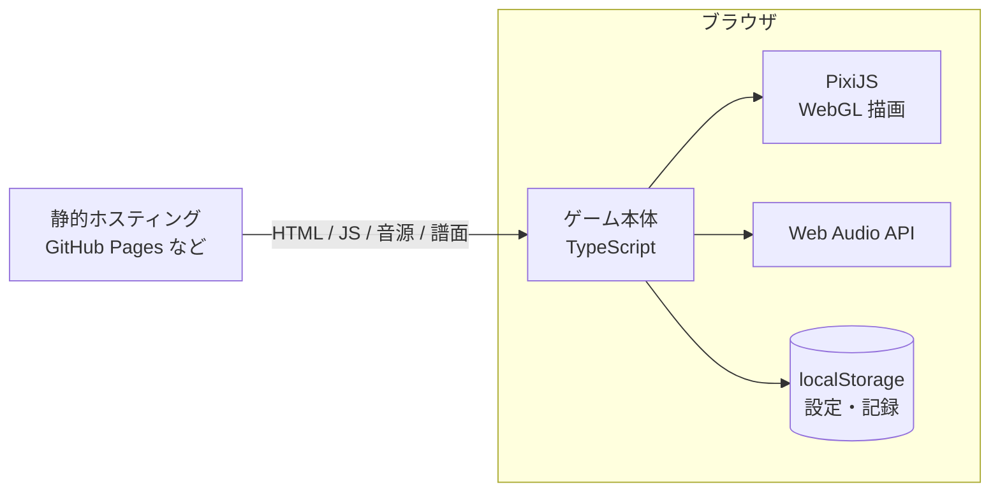
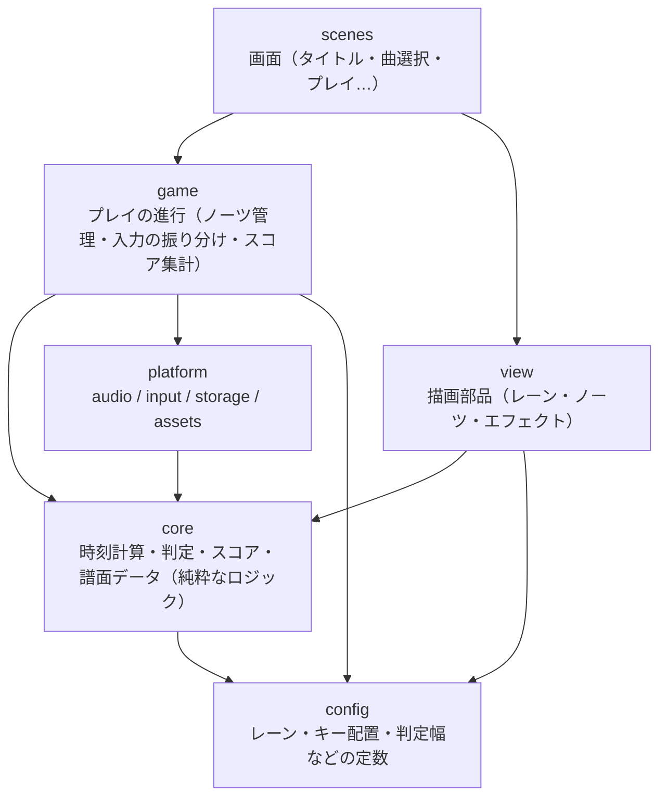
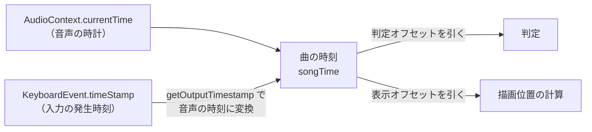
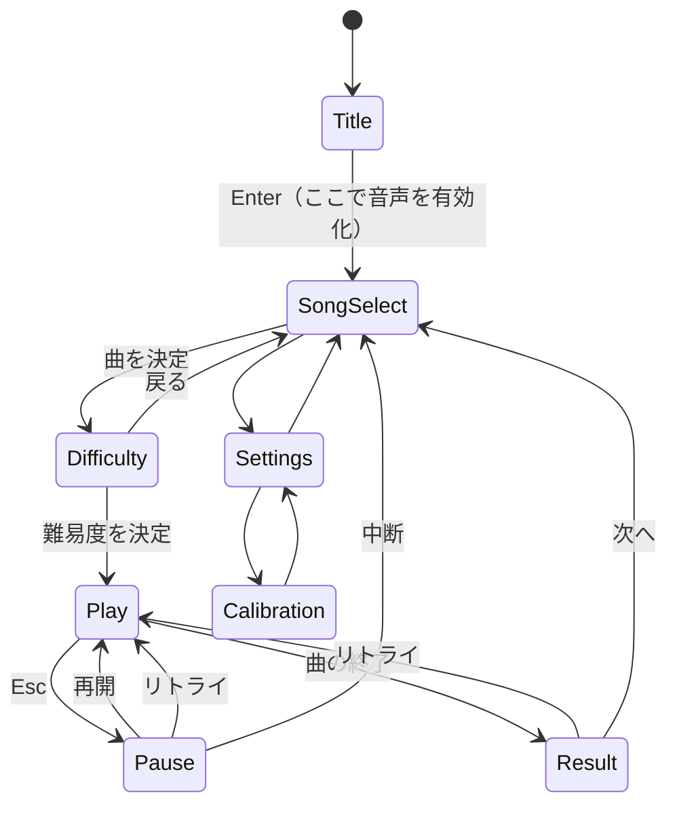
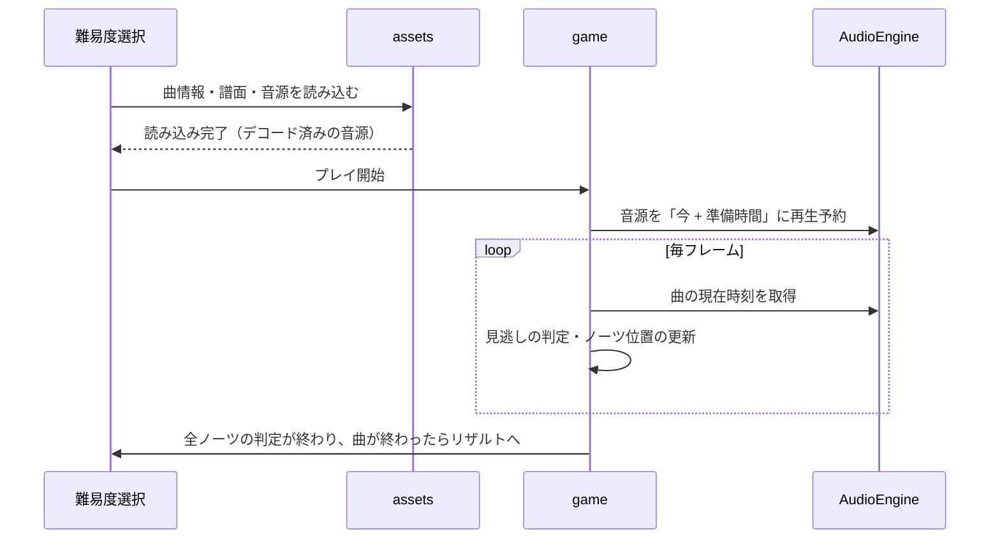
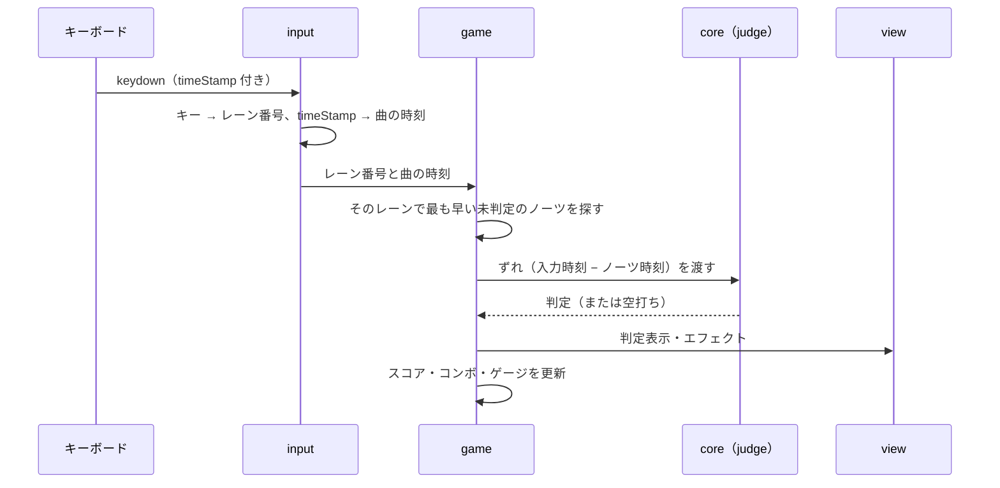

# 基本設計書

| 項目     | 内容                                                                   |
| -------- | ---------------------------------------------------------------------- |
| 対象     | game_music（ブラウザ音楽ゲーム）                                       |
| 版       | 0.1（2026-11-25）                                                      |
| 関連文書 | [要件定義書](01-requirements.md) / [詳細設計書](03-detailed-design.md) |

## 1. システム構成

静的サイトとしてビルドし、ブラウザだけで動く。サーバー側の処理はない（C-03）。



### 1.1 技術構成

| 区分       | 採用技術                           | 理由                                                   |
| ---------- | ---------------------------------- | ------------------------------------------------------ |
| 言語       | TypeScript 6（strict）             | 型でロジックの誤りを防ぐ                               |
| ビルド     | Vite 8                             | 開発サーバーが速く、静的サイトとして出力できる         |
| 描画       | PixiJS 8（WebGL）                  | 大量のノーツとエフェクトを高いフレームレートで描ける   |
| 音声       | Web Audio API（直接使用）          | 音声の時計を基準に、サンプル単位で再生時刻を指定できる |
| 単体テスト | Vitest 5                           | Vite と設定を共有できる                                |
| E2E テスト | Playwright                         | 実際のブラウザで画面の流れを確認する                   |
| 品質管理   | ESLint / Prettier / GitHub Actions | 整形・lint・型・テスト・ビルドを毎回自動で確認する     |

音声ライブラリ（Howler.js など）は使わない。再生時刻を細かく制御する必要があり、ライブラリを挟むとその制御が難しくなるため。

## 2. ソフトウェア構成

### 2.1 レイヤー

依存の向きは上から下だけとする。`core` は PixiJS・DOM・Web Audio のどれにも依存せず、単体テストだけで品質を保証する（NFR-21）。



### 2.2 ディレクトリ構成

```
src/
  main.ts            起動処理（PixiJS とシーン管理の初期化）
  config/            定数（レーン・キー配置・判定幅・色）
  core/              純粋なロジック。単体テストはここに集中させる
    clock.ts           時刻の変換
    timing.ts          BPM・拍子の変化を含む「拍 ⇔ 秒」の変換
    judge.ts           判定
    score.ts           スコア・コンボ・ゲージの計算
    chart/             譜面データの型・読み込み・検証
  platform/          ブラウザの機能を包む層
    audio/             AudioEngine（再生・効果音）、音源の読み込み
    input/             キー入力の受付と時刻の変換
    storage/           設定・記録の保存（版番号つき）
    assets/            曲一覧と音源・譜面の読み込み
  game/              プレイの進行
  view/              PixiJS の描画部品
  scenes/            画面
  editor/            譜面エディタ（開発用、Phase 3）
public/songs/        曲データ（音源・譜面・曲情報）
tools/               開発用のスクリプト（仮の曲の生成など）
e2e/                 E2E テスト
docs/                設計書類
```

Phase 2 時点の画面はタイトル（仮）とプレイ（一時停止・簡易リザルトを含む）だけで、そのほかの画面は Phase 4 で作る。`editor/` は Phase 3 で追加する。

## 3. 時刻管理の方針（最重要）

要件 NFR-01〜05 を満たすため、時刻は次の考え方で扱う。



1. **基準は音声の時計だけ。** 曲の再生は `AudioBufferSourceNode.start(開始時刻)` で、音声の時計の上の時刻を指定して始める。曲の現在時刻は「音声の時計 − 曲の開始時刻」で求める。
2. **入力は発生時刻で判定する。** キー入力のイベントに記録された時刻（`performance.now()` と同じ基準）を、`AudioContext.getOutputTimestamp()` が返す対応表で音声の時刻に変換してから判定する。
3. **描画位置は毎フレーム計算し直す。** ノーツの位置は「ノーツの時刻 − 曲の現在時刻」から求め、前のフレームの位置に足していく方式は使わない。フレーム落ちしても位置がずれない。
4. **オフセットは2種類。** 判定オフセット（音が耳に届くまでの遅れ）と表示オフセット（画面に映るまでの遅れ）を分けて補正する（FR-31、FR-32）。
5. **効果音・メトロノームは先読みで予約する。** 少し先（約 100ms）までの音を、音声の時計の上の時刻で予約して鳴らす。

## 4. 画面設計

### 4.1 画面遷移



### 4.2 画面一覧

| 画面               | 要件         | 主な操作                                                               |
| ------------------ | ------------ | ---------------------------------------------------------------------- |
| タイトル           | FR-20        | Enter で開始                                                           |
| 曲選択             | FR-21        | ↑↓ で曲を選ぶ、←→ でレーン数を変える、Enter で決定、試聴が自動で流れる |
| 難易度選択         | FR-22        | ↑↓ で選ぶ、Enter で決定、Esc で戻る                                    |
| プレイ             | FR-01〜18    | レーンのキーで演奏、Esc で一時停止                                     |
| 一時停止           | FR-07        | 再開・リトライ・中断                                                   |
| リザルト           | FR-17、FR-24 | Enter で次へ、R でリトライ                                             |
| 設定               | FR-30〜35    | 各項目の変更                                                           |
| 判定タイミング調整 | FR-26        | 一定間隔の音に合わせてキーを叩き、平均のずれからオフセットを提案する   |

### 4.3 プレイ画面の構成

| 領域           | 内容                                                       |
| -------------- | ---------------------------------------------------------- |
| 中央           | レーン、ノーツ、判定ライン、キー表示、押しているレーンの光 |
| 判定ラインの上 | 判定の文字、早い / 遅い、コンボ数                          |
| 上部           | スコア、曲の進み具合                                       |
| 横             | クリアゲージ                                               |
| 背景           | 曲ごとのテーマ（FR-53）                                    |

レーンの幅は、7レーンでも画面幅 1280px に収まる範囲で、レーン数に応じて調整する。

## 5. データ設計

### 5.1 データの一覧

| データ | 形式         | 置き場所                                        | 詳細           |
| ------ | ------------ | ----------------------------------------------- | -------------- |
| 曲一覧 | JSON         | `public/songs/index.json`                       | 詳細設計書 4.1 |
| 曲情報 | JSON         | `public/songs/<曲ID>/song.json`                 | 詳細設計書 4.2 |
| 譜面   | JSON         | `public/songs/<曲ID>/<難易度>.<レーン数>k.json` | 詳細設計書 4.3 |
| 音源   | 音声ファイル | `public/songs/<曲ID>/`                          | 下記 5.2       |
| 設定   | JSON         | localStorage                                    | 詳細設計書 4.4 |
| 記録   | JSON         | localStorage                                    | 詳細設計書 4.5 |

### 5.2 音源の形式

- 配信用の形式は **Ogg Opus** を第一候補とする（ファイルが小さく、音質が良い）。
- Safari で Ogg Opus を再生できない場合に備え、AAC（.m4a）も用意し、読み込み時にブラウザが再生できる方を選ぶ。対応状況は Phase 6 で実機確認する。
- MP3 はエンコード時に先頭へ無音が入り、その長さがエンコーダーごとに違ってずれの原因になるため使わない。
- 形式ごとの先頭のずれは、曲情報のオフセット（FR-54）で補正する。

## 6. 主要な処理の流れ

### 6.1 プレイ開始から終了まで



### 6.2 キー入力から判定まで



## 7. エラー処理の方針

| 場面                     | 対応                                                                         |
| ------------------------ | ---------------------------------------------------------------------------- |
| 音声を再生できない       | 画面にメッセージを出し、ゲームを始めない（NFR-32）                           |
| 音源・譜面の読み込み失敗 | 曲選択に戻り、どの曲で失敗したかを表示する                                   |
| 譜面の形式が不正         | 読み込み時に検証して弾き、エラー内容を表示する（開発時にすぐ気づけるように） |
| 保存データが壊れている   | 初期値で起動し直す。壊れたデータは別の名前で退避する                         |
| タブが裏に回った         | 曲を一時停止する（`visibilitychange`）                                       |

## 8. テストと品質保証の方針

| 種類       | 対象                                             | ツール     | 実行タイミング       |
| ---------- | ------------------------------------------------ | ---------- | -------------------- |
| 単体テスト | `core` の全モジュール                            | Vitest     | 保存時（watch）と CI |
| E2E テスト | 画面遷移、レーン数ごとの操作、エラーが出ないこと | Playwright | CI                   |
| 手動確認   | 叩いた感触、音と画面のずれ                       | 実機       | 各 Phase の終わり    |

## 9. 配信

- `npm run build` で `dist/` に静的ファイルを出力する。パスは相対パスにしておき、どの公開先にも置けるようにする。
- 公開先は GitHub Pages を第一候補とし、main ブランチへのマージで自動で公開する（Phase 7 で設定する）。
- ローカル専用の曲（`song.json` の `local: true`）は配信物に含めない。手元でビルドすると `dist/` に入ってしまうため、Phase 7 でビルド時に除外する仕組みを入れる。公開用のビルドは、ローカル専用の曲を持たない CI で作る。
